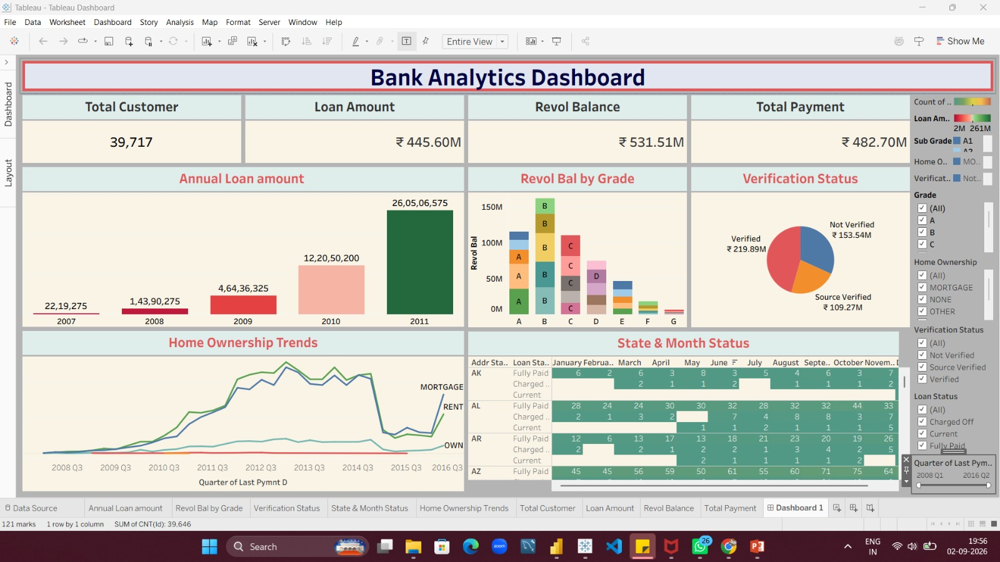

# Bank-loan-analysis

# 🏦 Bank Loan Analysis Dashboard

## 📌 Project Overview

The Bank Loan Analysis project focuses on analyzing 39,717 loan records from 2007 to 2011 to understand loan portfolio growth, customer behavior, borrowing patterns, and financial performance.

The project uses MySQL, MS Excel, Tableau, and Power BI to perform data analysis, calculate key performance indicators (KPIs), and develop interactive dashboards for business insights and risk monitoring.

## 🎯 Project Objectives

- Analyze year-wise loan origination trends.
- Understand customer profiles and loan distribution.
- Identify borrower risk indicators such as DTI, interest rates, and verification status.
- Analyze loan purposes and home ownership patterns.
- Monitor loan payments and financial performance.
- Build interactive dashboards for data-driven decision-making.

## 🛠️ Tools & Technologies

- **MySQL:** Data querying, filtering, aggregation, and KPI calculations.
- **MS Excel:** Data preparation, PivotTables, slicers, and interactive dashboards.
- **Tableau:** Interactive visualizations and trend analysis.
- **Power BI:** KPI reporting, interactive dashboards, and business intelligence.

## 📊 Key Performance Indicators (KPIs)

- Total Loan Amount: $445.6M
- Total Customers: 39,717
- Total Payment: $482.7M
- Revolving Balance: $531.5M
- Average Interest Rate: 12.02%
- Average DTI: 13.32

## 📈 Key Insights

- Loan originations increased approximately 118 times between 2007 and 2011.
- Debt consolidation represents more than half of the total loan value.
- Approximately 32% of the portfolio is marked as Not Verified.
- Mortgage and Rent borrowers account for approximately 92% of the portfolio.
- Grade B carries the largest concentration of revolving balance.

## 📂 Project Dashboards

This project includes dashboard development and analysis using:

1. MS Excel Dashboard
2. Tableau Dashboard
3. Power BI Dashboard
4. MySQL Queries for KPI calculations and advanced analysis

## 💡 Business Recommendations

- Strengthen borrower income and identity verification.
- Monitor debt consolidation loan concentration.
- Analyze state-wise loan performance and risk patterns.
- Maintain consistent KPI calculations across all reporting tools.

## 📌 Project Conclusion

This project demonstrates an end-to-end data analytics workflow, transforming raw bank loan data into meaningful business insights.

By combining SQL analysis with Excel, Tableau, and Power BI dashboards, the project helps understand loan portfolio growth, customer behavior, financial performance, and potential risk areas.

---

**Project:** Bank Loan Analysis

**Domain:** Banking & Financial Analytics

**Tools:** MySQL | MS Excel | Tableau | Power BI

 1. Tableau Dashboard Screenshort

